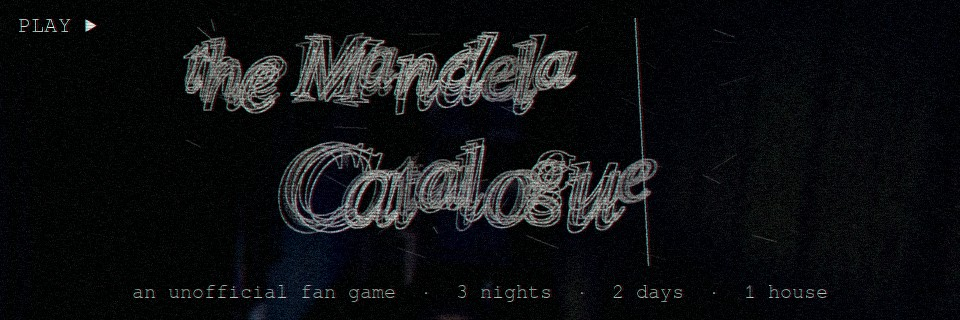
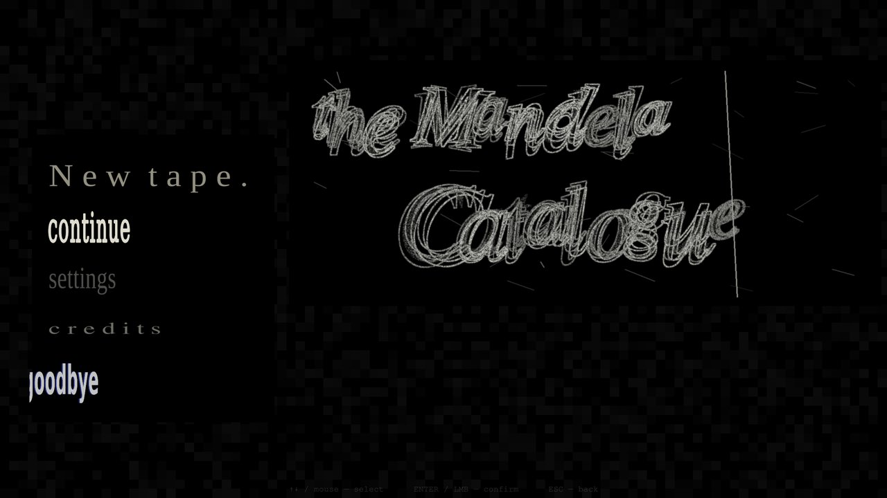
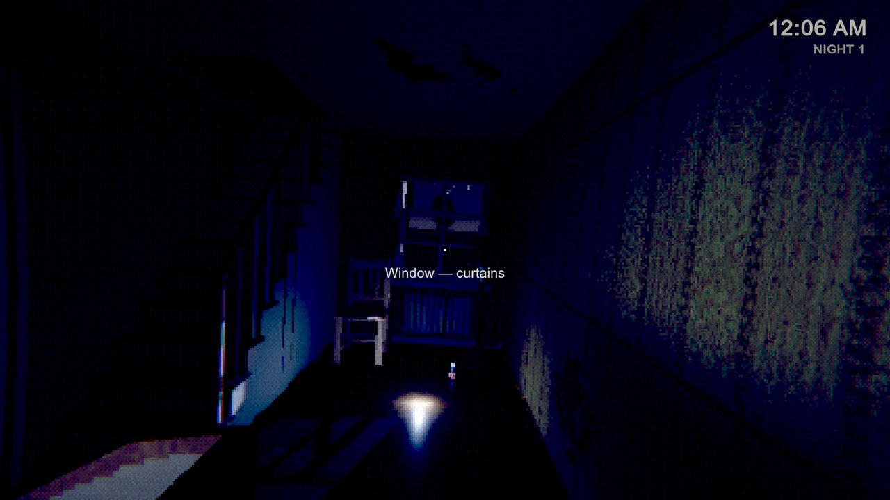
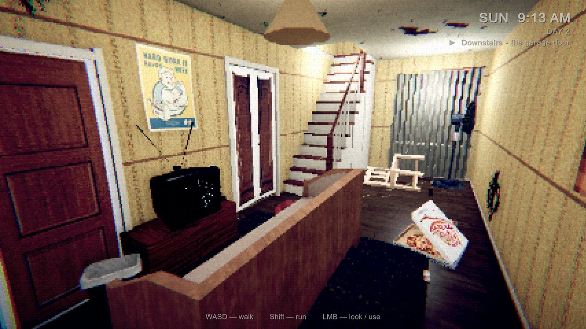
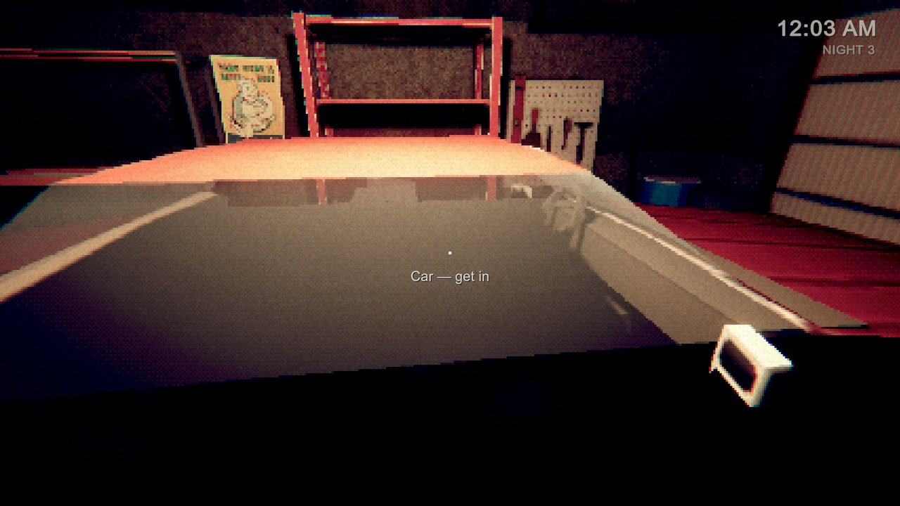
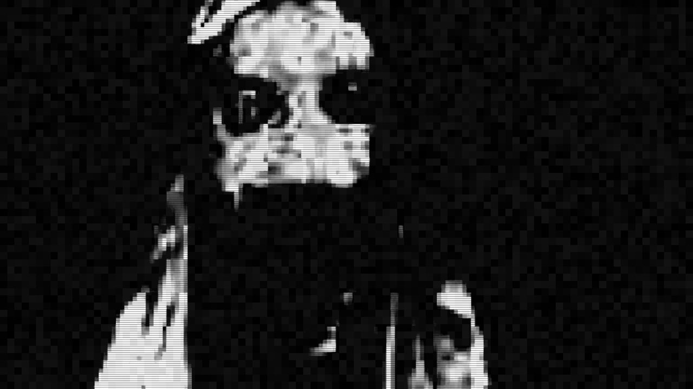

  

<h3 align="center">THIS IS NOT A TEST.</h3>

  <a href="https://spookytake.itch.io/the-mandela-catalogue"><b>▶ Play free on itch.io</b></a>
  &nbsp;·&nbsp; Windows &nbsp;·&nbsp; English / Русский

---

A short first-person **PSX-style analog horror** game based on *The Mandela Catalogue* by Alex Kister.
Three nights in Mark Heathcliff's house, and the days in between. They look like people you know. **Do not let them in.**

This repository contains the **game's source code and shaders** (Unity 6, URP). 3D models, textures, sounds and voices are **not included** — see [Assets](#assets).

## Screenshots

| | |
|---|---|
|  |  |
|  |  |

The trailer is on the [itch.io page](https://spookytake.itch.io/the-mandela-catalogue).

## What's inside

- **Intro** — a public-safety VHS tape, the drive home, Lynn's note on the fridge, a TV that turns itself on.
- **Night 1, the corridor** — door, window, stairs, TV and the M.A.D. signal, each with its own counter-action.
- **Night 2, the bedroom** — a knock, three seconds to hide; a working in-game laptop (desktop, chat, browser, decryption tool).
- **Night 3, the garage** — keys, fuel, the chain hoist, hiding in the car, and a noise meter that brings them in.
- **Days** — free walk through the house in daylight between the nights.
- Main menu, VHS tapes as save slots, settings, full **EN / RU localization**.
- Death screen built from flashing cuts and squashing / stretching case-file text.

## Code map

| Folder / file | What it does |
|---|---|
| `Scripts/NightRouter.cs` | Picks what the single scene becomes on load: menu, intro, a day or one of the nights |
| `Scripts/ThreatManager.cs`, `PanicPlayer.cs` | Night 1: threats (door, window, stairs, TV) and the hotspot-based player |
| `Scripts/StairsStalker.cs`, `AltReach.cs`, `StairFeetIK.cs` | The figure walking down the stairs, foot IK, head tilt |
| `Scripts/Night2/` | Bedroom night, hiding logic, the IMGUI laptop desktop and its content |
| `Scripts/Night3/` | Garage night, car hiding, noise meter, the finale |
| `Scripts/Day/` | Daytime free walk (CharacterController), inspectable items, day lighting |
| `Scripts/Intro/IntroDirector.cs` | The opening sequence |
| `Scripts/Menu/` | Main menu, settings / saves (`PlayerPrefs`), localization table |
| `Scripts/GameHUD.cs` | Camcorder OSD clock, briefings, the death screen |
| `Scripts/TrailerRecorder.cs` | Records gameplay at a fixed frame rate to MJPEG + audio (used for the trailer) |
| `Shaders/PSXLit.shader`, `PSXCommon.hlsl` | URP Lit with PS1-style vertex snapping (geometry 'swims' on a coarse pixel grid) |
| `Shaders/PSXPost.shader`, `MadDistortion.shader` | Chunky-pixel, Bayer-dithered post effect and the M.A.D. signal distortion |

## Assets

Models, textures, sounds and fonts come from third-party packs and from the original series, so they are not redistributed here. Full credits are in the game (Credits menu) and in `CREDITS.txt` inside the itch.io download.

## Disclaimer

This is an **unofficial, non-commercial fan game**. It is not affiliated with or endorsed by Alex Kister.
*The Mandela Catalogue*, its setting and characters belong to Alex Kister — watch the original series: https://www.youtube.com/@AlexxKister

## About AI

The game was made with the help of AI tools: Claude (code, some textures, the death-screen sound, the trailer edit) and ElevenLabs (character voices).

## License

The source code in this repository is released under the [MIT License](LICENSE). It does not cover any third-party assets or *The Mandela Catalogue* IP. `Shaders/PSXLit.shader` is derived from Unity's URP Lit shader and stays under the [Unity Companion License](https://unity.com/legal/licenses/unity-companion-license).

---

Русский: бесплатная неофициальная фан-игра по The Mandela Catalogue. В репозитории только код и шейдеры (Unity 6, URP); модели, звуки и текстуры не выкладываются. Играть — на <a href="https://spookytake.itch.io/the-mandela-catalogue">itch.io</a>.
